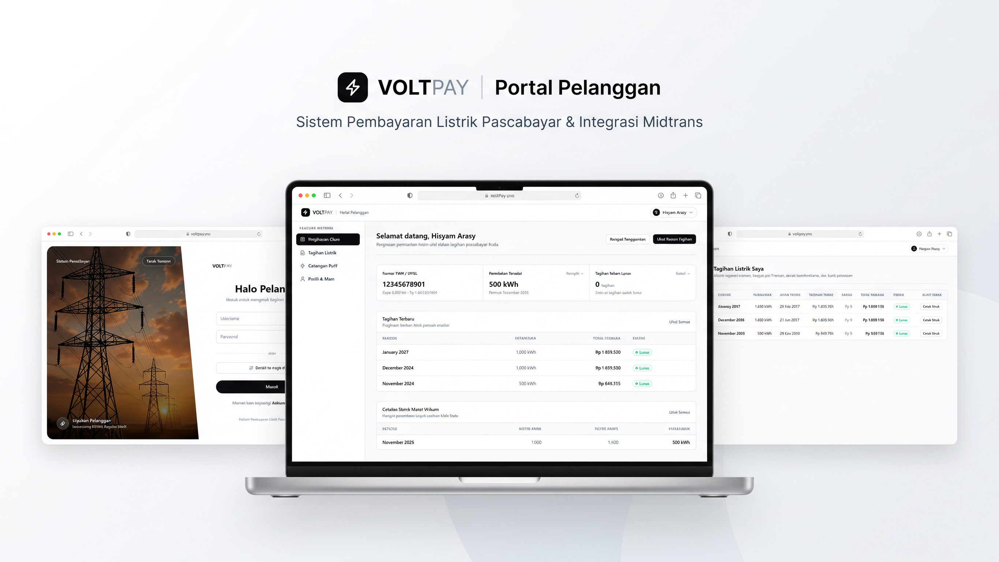

# VOLTPAY — Aplikasi Pembayaran Listrik Pascabayar

**VOLTPAY** adalah aplikasi manajemen tagihan dan pembayaran listrik pascabayar berbasis **Laravel 12** dan **MySQL** dengan antarmuka monokromatik modern. Aplikasi ini mendukung pencatatan penggunaan meteran bulanan, kalkulasi tarif & denda keterlambatan otomatis, pembayaran melalui loket kasir maupun pembayaran mandiri pelanggan secara _real-time_ menggunakan **Midtrans Snap Sandbox**.

<div align="center">
  

# VOLTPAY — Sistem Pembayaran Listrik Pascabayar

[](https://laravel.com)
[](https://php.net)
[](https://midtrans.com)
[-green.svg>)](tests)

  <p>Aplikasi web pengelolaan listrik pascabayar terintegrasi dengan gateway pembayaran online Midtrans Snap (Sandbox), manajemen pelanggan, pencatatan kWh, dan rekapitulasi laporan otomatis.</p>
</div>

## Fitur Utama

### 1. Portal Administrator & Petugas Loket

- **Manajemen Master Data**: Pengelolaan data pelanggan (nomor kWh, daya, alamat), kategori tarif listrik per kWh, dan akun petugas/kasir dengan kontrol akses berbasis peran (_Role-Based Access Control_).
- **Pencatatan Penggunaan Meter**: Validasi otomatis agar meter awal tidak lebih kecil dari meter akhir bulan sebelumnya, serta pembuatan tagihan bulanan secara otomatis.
- **Loket Pembayaran Tunai**: Pemrosesan pembayaran langsung di loket lengkap dengan pencatatan biaya admin dan cetak bukti pembayaran.
- **Laporan & Rekapitulasi**: Ringkasan pendapatan bulanan, filter transaksi berdasarkan kanal pembayaran (Loket Tunai vs Midtrans Online), pembatalan transaksi (khusus Administrator), serta ekspor laporan ke format **CSV**.

### 2. Portal Pelanggan

- **Dashboard & Riwayat Penggunaan**: Pemantauan pemakaian listrik (kWh) bulanan dan rincian tagihan aktif.
- **Pembayaran Online via Midtrans Snap**: Pelunasan tagihan mandiri menggunakan Virtual Account (BCA, BNI, BRI, Mandiri, Permata), GoPay, dan QRIS.
- **Cetak Struk Digital**: Bukti pelunasan resmi untuk transaksi tunai maupun pembayaran online (`id_user = null`).
- **Keamanan Akun**: Aktivasi mandiri akun pelanggan dan pembaruan profil/kata sandi dengan proteksi _rate limiter_.

### 3. Keandalan & Keamanan Integrasi Midtrans

- **Reuse Snap Token (Caching)**: Menyimpan `snap_token` aktif di cache berdasarkan ID tagihan dan total nominal untuk mencegah pembuatan `order_id` ganda saat popup ditutup dan dibuka ulang.
- **Verifikasi Signature SHA-512**: Validasi keamanan notifikasi webhook `/webhooks/midtrans` menggunakan perbandingan _timing-attack safe_ (`hash_equals`).
- **Atomic Locking & Idempotency**: Menggunakan `DB::transaction` dengan `lockForUpdate()` serta pengecekan `midtrans_order_id` untuk mencegah pencatatan pembayaran ganda (_race condition_).
- **Penanganan Status Non-Settlement**: Menangani status `expire`, `cancel`, dan `deny` dengan membersihkan cache token agar pelanggan dapat membuat transaksi baru.

---

## Teknologi yang Digunakan

- **Backend**: PHP 8.2+, Laravel 12
- **Database**: MySQL 8.0 / MariaDB (SQLite untuk lingkungan _testing_)
- **Frontend**: Blade Templates, Tailwind CSS, Vite
- **Payment Gateway**: Midtrans Snap (`midtrans/midtrans-php`)
- **Testing**: PHPUnit (Feature & Unit Tests)

---

## Instalasi & Menjalankan di Lokal

### 1. Clone Repository & Instal Dependensi

```bash
git clone https://github.com/username/Aplikasi-Pembayaran-Listrik.git
cd Aplikasi-Pembayaran-Listrik

composer install
npm install
```

### 2. Konfigurasi Environment

Salin file `.env.example` menjadi `.env`, lalu buat _application key_:

```bash
cp .env.example .env
php artisan key:generate
```

Sesuaikan pengaturan database dan kredensial **Midtrans Sandbox** di dalam file `.env`:

```env
APP_NAME=VOLTPAY
APP_ENV=local
APP_DEBUG=true
APP_URL=http://localhost:8000

DB_CONNECTION=mysql
DB_HOST=127.0.0.1
DB_PORT=3306
DB_DATABASE=voltpay
DB_USERNAME=root
DB_PASSWORD=

MIDTRANS_SERVER_KEY=your-sandbox-server-key
MIDTRANS_SIGNATURE_KEY=your-sandbox-server-key
MIDTRANS_CLIENT_KEY=your-sandbox-client-key
MIDTRANS_IS_PRODUCTION=false
MIDTRANS_IS_SANITIZED=true
MIDTRANS_IS_3DS=true
MIDTRANS_ADMIN_FEE=2500
MIDTRANS_EXPIRY_MINUTES=60
```

### 3. Migrasi Database & Jalankan Server

```bash
php artisan migrate --seed
npm run dev
php artisan serve
```

---

## Menguji Webhook Midtrans di Lokal

Untuk menerima notifikasi pelunasan otomatis dari Midtrans Sandbox ke server lokal:

1. Jalankan _tunneling_ HTTPS (misalnya menggunakan **Ngrok**):
    ```bash
    ngrok http 8000
    ```
2. Salin URL HTTPS yang dihasilkan (contoh: `https://xxxx.ngrok-free.app`).
3. Masuk ke **Midtrans Sandbox Dashboard** $\rightarrow$ **Settings** $\rightarrow$ **Payment** $\rightarrow$ **Notification URL**, lalu isi dengan:
    ```text
    https://xxxx.ngrok-free.app/webhooks/midtrans
    ```

---

## Pengujian Otomatis (Automated Testing)

Proyek ini dilengkapi dengan 25 skenario pengujian otomatis (87 _assertions_) yang mencakup logika denda, otorisasi peran, alur portal pelanggan, _caching_ Snap Token, serta keamanan _webhook_ Midtrans.

Jalankan seluruh pengujian dengan perintah:

```bash
php artisan test
```

---

## Lisensi

Proyek ini dikembangkan untuk kebutuhan pembelajaran dan portofolio pengembangan sistem pembayaran web.
